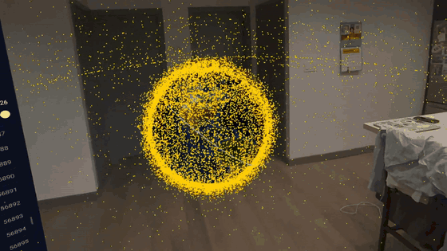

# SatViz

https://satviz.nikosward.com/

Interactive AR/VR/web app for visualizing satellites and other man-made objects orbiting Earth in real time.

Demo of AR functionality: [https://youtu.be/W58HhXezaD8](https://youtu.be/W58HhXezaD8)



## Features

- AR/VR immersive experience for Meta Quest & Android
- 3D globe with live satellite positions
- Real-time orbital animation (propagation in the browser)
- Satellite search and filtering (by name, type, and launch year)
- Select to view satellite details (name, altitude, velocity, orbital period)

## AR/VR

I built SatViz for Meta Quest, but other devices that support WebXR may also work. You can try to access the AR/VR mode by visiting the second (AR/VR) tab, or manually adding `?renderer=xr` to the URL. These are untested and likely missing functionality:

- Apple Vision Pro (Safari): Safari supports VR but not WebXR Layers, so panels fall back to regular blurry 3D meshes. Likely works but with limited interactions.
- Desktop Chrome with a headset (for example, Quest Link): Likely works but with limited interactions.
- Android phones: Touch input works, but I can’t guarantee that all interactions do.

## Tech Stack

| Layer        | Technology                                        |
| ------------ | ------------------------------------------------- |
| Frontend 3D  | WebGPU, Three.js (for performance comparison!)    |
| Frontend UI  | React                                             |
| Orbital Math | satellite.js (SGP4, in a Web Worker)              |
| Backend      | Python publish job; FastAPI for local development |
| Hosting      | Cloudflare Pages and R2; GitHub Actions           |
| Data Source  | Spacebook                                         |
| Database     | PostgreSQL (local development)                    |

## Project Structure

```
SatViz/
├── frontend/          # React + WebGPU visualization
├── backend/           # FastAPI server
└── docs/
    └── SatViz DD.md   # Technical design document
```

## Getting Started

TODO! See `docs/SatViz DD.md` for full technical details, architecture, and roadmap.

## Roadmap

- Country of origin data.
- Color coding based on object type.
- Pass predictions and satellite conjunction analysis (close-approach prediction).
- Time slider for past/future position data.
